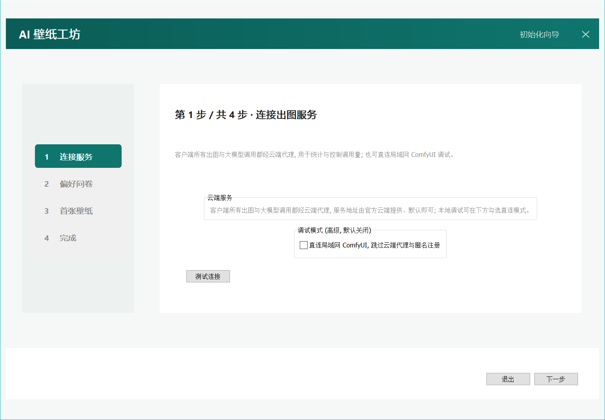
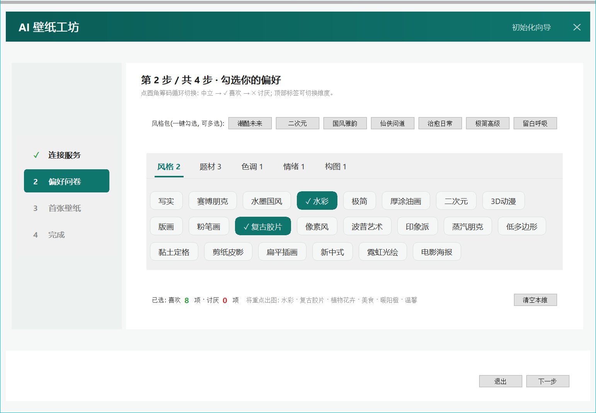

# AI 壁纸工坊

[中文](README.md) | [English](README.en.md)

> 每小时,桌面自己变好看。AI 为你一个人出图、自动换壁纸的 Windows 工具。

<p align="center">
  
  
</p>
<p align="center"><sub>以上均为项目实际出图: 提示词由云端 LLM 结合用户画像与历史自动规划</sub></p>

**AI 壁纸工坊**不是一个壁纸图库,而是一台为你一个人工作的壁纸生成器:
Windows 计划任务每小时静默触发一次 → 云端 LLM 结合你的偏好画像与近期历史规划提示词 →
ComfyUI(Z-Image Turbo)出图 → 按屏幕物理分辨率适配 → 自动更换桌面壁纸。**你什么都不用做。**

零注册、零登录、无托盘、无常驻进程——关掉窗口,系统里就没有它的进程。

**当前版本: v1.2.0** · 官网 [cybermesh.space](https://www.cybermesh.space) · 客户端约 14 MB 单文件。

## 下载

| 渠道 | 地址 | 说明 |
| --- | --- | --- |
| 官网 | https://www.cybermesh.space | 点「下载 Windows 版客户端」即可 |
| Gitee Release(国内推荐) | https://gitee.com/QQ941748/ai-wallpaper-workshop/releases | 下载最新版本的 `AIWallpaper.exe` |
| GitHub Release(备用) | https://github.com/941748/ai-wallpaper-workshop/releases | 同上, 海外访问更快 |

- 系统要求: Windows 10 / 11(64 位) + WebView2 运行时(Win11 自带; 缺失时程序会提示并自动下载安装)。
- 下载后双击 `AIWallpaper.exe` 进入初始化向导; 走完向导即开始自动换图。
- **已装用户无需手动升级**: 客户端每次换图时会静默检查更新, 自动下载校验并换装。
- **安卓版**: 官网点「下载安卓版」或 Gitee Release 的 `AIWallpaper-Android-*.apk`; 应用内同样静默检查更新。

## 特性

- **无感偏好学习**: 五维问卷(风格 / 题材 / 色调 / 情绪 / 构图, 风格包一键勾选)建立画像;
  之后在你自然操作(重跑向导、重新应用历史壁纸、满意度回访)中检测偏好漂移, 静默微调画像。
- **每小时自动更新**: 计划任务触发秒级进程, 出图换图后退出, 无后台驻留。
- **云端 LLM 规划 + 静默降级**: LLM 结合画像、近 10 轮记录与漂移事件规划下一张;
  不可达/超时时自动回退本地加权采样引擎, 用户无感。
- **节日与节气语境**: 二十四节气与主要节日临近时, 画面氛围含蓄呼应(如母亲节以康乃馨色柔光致意), 只渲染氛围、不做文字横幅; 可一键关闭。
- **本地备用池, 断网也能换**: 本机始终储备最多 3 张已生成壁纸, 池子消耗后**按缺额一次补足**(最多一轮 3 张); 断网或出图拥挤时照样秒换。
- **预生成池**: 出图机空闲时提前生成下一轮, 命中时换壁纸仅需十余秒(省去现场出图的约 30 秒)。
- **不打扰**: 安静时段、全屏应用、锁屏统统跳过; 满意度回访走记忆曲线(3→7→15→30→60→90 天封顶), 时点更少但永不消失。
- **隐私友好**: 匿名 token, 零注册; 画像与历史全部留在本机; 出站调用统一走你自托管的云服务。
- **轻**: 客户端为 ~14MB 单文件(Go 编译, 内嵌 WebView2 引导器; Win11 自带运行时)。

## 截图

四步向导: 连接服务 → 偏好问卷(五维三态筹码, 可一键勾选风格包) → 首张壁纸 → 完成(每小时任务在完成页静默注册)。

<p align="center">
  
  
</p>

<p align="center">
  
</p>

## 工作原理

```
┌────────── 客户端(Windows 单文件 ~14MB / 安卓 APK)──────────┐
│ 向导·设置·历史收藏    计划任务 tick · 断点续传 · 静默自更新    │
│ 本地提示词引擎(LLM 不可达时兜底)   画像 / 漂移信号           │
└────────────────────────┬──────────────────────────────────┘
                 HTTPS(匿名 token, 仅出站)
┌────────────────────────▼──────────────────────────────────┐
│  云服务(Go + SQLite 单二进制, 自托管)                        │
│  匿名注册/配额/限流      LLM 写正向提示词, 规则合成反向提示词  │
│  出图任务队列(normal/idle)  预生成池·画像历史/收藏·自更新分发 │
└────────────────────────┬──────────────────────────────────┘
            领任务与回报(出图机 aw-agent 主动外拨, 仅出站)
┌────────────────────────▼──────────────────────────────────┐
│  出图机 aw-agent(单进程, 取代 frpc 隧道)                    │
│  领任务→本地工作流模板注入→ComfyUI(Z-Image Turbo)→转码上传   │
│  ComfyUI 看门狗自动拉起 · 崩溃自愈 · 版本管理与自动更新      │
└────────────────────────┬──────────────────────────────────┘
                  PUT 直传(国内链路)
┌────────────────────────▼──────────────────────────────────┐
│  阿里云 OSS(私有桶, u/{user}/{W}x{H}/{job}.jpg)           │
│  客户端经签名 URL 302 直下; 云服务只签 URL, 不碰图片字节      │
└──────────────────────────────────────────────────────────┘
```

### 偏好是怎么"学"到的

1. **问卷三态**: 五维共 90 个词条(风格 22 / 题材 42 / 色调 6 / 情绪 10 / 构图 10),
   点选"喜欢 / 中立 / 讨厌", 映射为画像权重(0.9 / 0.3 / 0.05); 风格包可一键勾选。
2. **漂移检测**: 只采纳真实用户行为(重跑向导、重新应用某张壁纸、调权重、回访选择),
   同向证据积累后微调画像; 不依赖"壁纸存活时长"之类的推测信号, 避免打扰与误判。

## 快速开始

出图链路唯一形态: **客户端 → 云端 → 出图机(aw-agent)**, 无其他模式。

1. 一台服务器(可与出图机同机): 编译运行云服务(见「云服务部署」), 配置 LLM 密钥与 OSS 密钥。
2. 一台出图机: ComfyUI + 消费级 NVIDIA 显卡(Z-Image Turbo 1080p 约 30 秒/张),
   再运行 `aw-agent.exe`(见「ComfyUI 准备清单」)——领任务、出图、上传全由它完成, 无需任何入站端口。
   本地部署同理: 出图机侧仍以 aw-agent 作为中间层接入云端。
3. 客户端向导填云服务地址 → 完成。

## 构建

要求: Go 1.22+(windows/amd64)。依赖仅 `lxn/walk`、`golang.org/x/sys`、`golang.org/x/image`、
`golang.org/x/text`、`skip2/go-qrcode`、`modernc.org/sqlite`(纯 Go, 无 CGO)。

```powershell
# 一键构建: 跑测试 → dist\AIWallpaper.exe(GUI 无窗口) + dist\aiwallpaper-cloud.exe
powershell -ExecutionPolicy Bypass -File build.ps1

# 云服务部署到 Linux 服务器时, 构建 Linux 版二进制
$env:AW_BUILD_OS = "linux"; powershell -ExecutionPolicy Bypass -File build.ps1

# 出图机统一代理(领任务渲染 + OSS 上传 + 看门狗 + 自动更新)
go build -trimpath -ldflags "-s -w" -o distw-agent.exe ./aw-agent
```

日常开发:

```powershell
go test ./...     # 全部单元/集成测试(含跨模块端到端: 真实 tick ↔ 真实云服务 ↔ 模拟出图机代理/LLM)
go vet ./...
go build -trimpath -ldflags "-s -w -H=windowsgui" -o dist\AIWallpaper.exe .
```

> 命名说明: 构建产物与对外分发名统一为 `AIWallpaper.exe`
> (即用户在官网 / Release 下载、以及安装后位于 `%LOCALAPPDATA%\AIWallpaper\bin\` 的文件名)。
> 旧版本安装名 `wallpaper.exe` 会在下次计划任务运行时自动迁移。

## 项目结构

```
wallpaper/
├── main.go                       # 无参=GUI(向导/设置);--tick=静默单次;--apply-update=换装助手
├── build.ps1                     # 一键构建(测试 → 客户端 → 云服务)
├── assets/workflow_template.json # Z-Image Turbo 工作流模板(占位符注入; 出图机 aw-agent 的 default.json 与其同源)
├── aw-agent/                    # 出图机统一代理(领任务渲染+OSS上传+看门狗+自动更新)
├── internal/
│   ├── config/                   # 配置与画像读写(%LOCALAPPDATA%\AIWallpaper)
│   ├── taxonomy/                 # 5 维属性词典(风格/题材/色调/情绪/构图)
│   ├── prompt/                   # 本地提示词引擎(加权采样/探索/去重/负面词)
│   ├── backend/                  # ImageBackend 接口(cloud 实现 / runninghub 预留)
│   ├── desktop/                  # 分辨率探测/缩放裁切/换壁纸/安静检测/低优先级
│   ├── scheduler/                # 计划任务 XML 生成与 schtasks 注册/删除/立即运行
│   ├── store/                    # 数据目录/文件锁/日志轮转/壁纸留档清理
│   ├── signals/                  # 漂移事件采集(重配置/重选壁纸/调权重/回访选择)
│   ├── cloud/                    # 云服务客户端(注册/取提示词/上报/补传队列)
│   ├── update/                   # 静默自更新(版本查询/下载校验/助手换装)
│   ├── tick/                     # --tick 全流程编排(含满意度回访与自更新)
│   └── ui/                       # walk 原生窗口: 向导/设置/回访小窗
├── cloud/                        # 独立云服务(单独编译部署)
│   ├── main.go                   # 装配 + 管理看板 /admin?token=
│   ├── api.go                    # /api/v1 全部接口
│   ├── handlers_agent.go         # 出图机代理协议(claim/rendered/版本上报)
│   ├── queue.go                  # 协调器(主动预生成钩子 + 代理卡死回收)
│   ├── prompts.go                # LLM 规划 + 容错解析 + 本地引擎兜底
│   ├── workflows.go              # 出图工作流注册表(白名单)
│   ├── llm/client.go             # OpenAI 兼容 LLM 客户端(默认小米 MiMo)
│   └── store/                    # SQLite: users/prompt_records/signals/jobs/pregen/archive/...
├── site/                         # 官网静态页(推广与客户端下载)
└── docs/screenshots/             # README 截图
```

## 客户端使用

| 运行方式 | 行为 |
| --- | --- |
| 双击运行(无参数) | 首次 → 初始化向导; 之后 → 设置面板。**关闭窗口 = 进程立即退出** |
| `AIWallpaper.exe --tick` | 计划任务每小时触发: 无窗口静默出图换壁纸后退出 |
| `AIWallpaper.exe --apply-update ...` | 内部换装助手(静默自更新用, 普通用户无需关心) |

设置面板页签: 偏好(权重调节/重新初始化) | 服务与调度(地址/测试连接/间隔/任务注册与删除/立即换一张) |
历史(缩略图/重新应用/打开目录) | 同步(匿名 user_id/扫码配对新设备) | 更新与回访(版本/更新检查/回访周期)。

以上手工操作(重跑向导重选、历史页重新应用、调权重)均本地记为漂移事件并上报云端,
作为 LLM 生成下一轮提示词的依据。

数据目录 `%LOCALAPPDATA%\AIWallpaper\`:

```
config.json          主配置(云端地址/相位/安静时段/满意度周期)
profile.json         偏好画像(5 维权重 + 负面片段)
prompt_history.json  最近 200 条出图组合(近 30 条去重)
cloud_queue.json     离线补传队列(最多重试 7 天)
signals.json         待上报的漂移事件
wallpapers\         壁纸留档(全部保留, 不设上限, 磁盘空间自行管理)
bin\AIWallpaper.exe  向导注册计划任务时复制的正式副本
logs\runtime.log     运行日志(1MB × 3 份轮转)
```

卸载: 设置页 → 服务与调度 → 删除计划任务, 然后删除上述目录即可。

## ComfyUI 准备清单

出图由出图机上的 `aw-agent` 领取云端任务后本地渲染, ComfyUI 侧只需:

1. 本机可访问即可: aw-agent 探测 `127.0.0.1` 的 8188/18188 端口,
   **无需对云服务或局域网开放任何入站端口**(frpc 隧道已退役)。
2. 安装 Z-Image Turbo 工作流所需模型:

   - `models/diffusion_models/z_image_turbo_int8_convrot.safetensors`(UNet)
   - `models/text_encoders/qwen_3_4b_fp4_mixed.safetensors`(CLIP, lumina2)
   - `models/vae/ae.safetensors`(VAE)

3. **工作流模板随 aw-agent 分发**: 与 exe 同目录的 `default.json` 即模板, 含
   `{{POSITIVE}}/{{NEGATIVE}}/{{WIDTH}}/{{HEIGHT}}/{{SEED}}` 占位符——换模型、换工作流只改这一个文件, 不动程序。
   云端 `clouddata/workflows.json` 注册表(首次启动生成)负责工作流 ID 与出图尺寸范围(min_side/max_side),
   未知 ID 自动回落 `default.json`; 注册表示例:

   ```json
   [
     {"id":"wf-base","name":"Z-Image Turbo 通用","checkpoint":"z_image_turbo_int8_convrot.safetensors",
      "steps":8,"cfg":1,"sampler_name":"res_multistep","scheduler":"simple","min_side":512,"max_side":1920},
     {"id":"wf-small","name":"小尺寸档","checkpoint":"z_image_turbo_int8_convrot.safetensors",
      "steps":8,"cfg":1,"sampler_name":"res_multistep","scheduler":"simple","min_side":512,"max_side":1088}
   ]
   ```

   保存后重启云服务生效; LLM 仅在白名单内选择工作流。客户端无需任何改动, 默认出图尺寸 1920×1080。
4. 无需安装 ComfyUI 节点插件: 模板为标准节点(CLIP 编码 → AuraFlow 采样 → KSampler → VAEDecode → SaveImage),
   只要求上述标准节点与模型存在。
5. aw-agent 自带看门狗: 连续心跳失败会按 `aw-agent.json` 的 `comfyui_cmd`(同目录批处理名)自动拉起 ComfyUI,
   并定期经 `agent/latest` 检查、自动更新自身。

## 云服务部署

### 环境变量

| 变量 | 默认值 | 说明 |
| --- | --- | --- |
| `AW_ADDR` | `:8707` | 监听地址 |
| `AW_DATA` | `./clouddata` | 数据目录(db/成品图/预生成/更新包) |
| `AW_LLM_BASE` | `https://token-plan-cn.xiaomimimo.com/v1` | OpenAI 兼容 LLM 地址(默认小米 MiMo, 可换任意兼容服务) |
| `AW_LLM_KEY` | 空 | LLM 密钥(**仅存服务端**; 留空则提示词回退本地引擎, 仍可出图) |
| `AW_LLM_MODEL` | `mimo-v2.6-flash` | 模型名 |
| `AW_ADMIN_TOKEN` | 空 | 管理看板口令; 为空时看板关闭(404) |
| `AW_SITE` | `/opt/aiwallpaper/site` | 官网静态页目录(内置官网托管) |
| `AW_OSS_AK_ID` / `AW_OSS_AK_SECRET` | 空 | 阿里云 OSS 密钥(**仅存服务端**; 云模式必需——图片存 OSS、签名 URL 直下) |
| `AW_OSS_BUCKET` / `AW_OSS_ENDPOINT` | 空 | OSS 桶名与接入点(如 `oss-cn-hangzhou.aliyuncs.com`) |
| `AW_AGENT_TOKEN` | 空 | 出图机代理 aw-agent 鉴权口令(与 aw-agent.json 同值; 为空时代理接口 503) |
| `AW_QUOTA_GEN_HOUR` / `AW_QUOTA_GEN_DAY` | `10` / `40` | 每用户出图配额(超出返回 429; 安卓另有独立日配额) |
| `AW_QUOTA_ANDROID_DAY` | `40` | 安卓端独立出图日配额(与 PC 分开计数) |
| `AW_QUOTA_LLM_HOUR` / `AW_QUOTA_LLM_DAY` | `10` / `40` | 每用户 LLM 调用配额(双端独立作用域) |

> 配额等数值可用 systemd `EnvironmentFile`(如 `quota.env` drop-in)覆盖——改文件重启即生效, 无需重新编译;
> 密钥类变量也建议放 EnvironmentFile, 避免明文进 unit 文件。

### systemd 部署

```ini
# /etc/systemd/system/aiwallpaper-cloud.service
[Unit]
Description=AI Wallpaper Cloud
After=network.target

[Service]
User=aiwallpaper
WorkingDirectory=/opt/aiwallpaper
Environment=AW_ADDR=127.0.0.1:8707
Environment=AW_DATA=/var/lib/aiwallpaper
Environment=AW_LLM_KEY=<你的 LLM 密钥>
Environment=AW_ADMIN_TOKEN=change-me
# 另需 AW_OSS_*(图片存储) 与 AW_AGENT_TOKEN(代理鉴权), 见上表;
# 密钥建议放 EnvironmentFile drop-in 而非写进本文件
ExecStart=/opt/aiwallpaper/aiwallpaper-cloud
Restart=on-failure

[Install]
WantedBy=multi-user.target
```

```bash
sudo systemctl daemon-reload && sudo systemctl enable --now aiwallpaper-cloud
```

### nginx 反向代理(可选, 生产环境建议 HTTPS)

```nginx
server {
    listen 443 ssl;
    server_name wallpaper.example.com;
    # ssl_certificate ...; ssl_certificate_key ...;

    client_max_body_size 32m;

    location / {
        proxy_pass http://127.0.0.1:8707;
        proxy_set_header Host $host;
        proxy_set_header X-Forwarded-Proto $scheme;
        proxy_read_timeout 120s;
    }
}
```

> 提示: 云服务不需要 WebSocket; 客户端全链路为 HTTP 轮询, 反代无需额外配置。
> 配对中转页与更新包下载走同一域名(`/d/{code}`、`/releases/`); 官网由云服务内置托管(`AW_SITE`)。

### 管理看板

浏览器访问 `https://<你的域名>/admin?token=<AW_ADMIN_TOKEN>`:
查看全部用户(今日 LLM/出图用量、禁用状态)、最近出图记录、漂移事件、任务队列状态、出图机代理在线状态与版本、官网访问统计(PV/UV/下载)。

## 客户端版本发布(静默自更新)

1. 递增代码中的版本号(`internal/version/version.go` 的 `Version`, 客户端与云服务共用), 构建新客户端,
   产物重命名为 `AIWallpaper-<version>.exe`。
2. 计算 sha256 与大小, 连同发布说明写入服务端 `releases/manifest.json`:

   ```json
   {
     "version": "1.2.0",
     "file": "AIWallpaper-1.2.0.exe",
     "sha256": "<64 位 hex>",
     "size": 10866176,
     "notes": "v1.2.0: 全新界面·云端历史秒开·单一云端链路",
     "url": "https://www.cybermesh.space/go/dl"
   }
   ```

   - `file`: 相对服务端 `releases/` 目录的文件名(默认下载源)。
   - `url`(可选): **下载源覆盖**。填写后所有客户端(含旧版)立即改从该地址下载,
     无需升级客户端代码——用于切换国内 CDN(如 Gitee 直链)、临时回退备用源或灰度测试。
     留空则用 `<scheme>://<host>/releases/<file>` 的默认地址。
3. 把 exe 放进服务端 `releases/` 目录。**无需其他动作**: 每个 tick 尾部客户端会查询
   `/api/v1/client/latest`, 有新版本即静默下载 → sha256 + 大小校验 → 助手进程
   (`--apply-update`)在 tick 退出后原子换装, 下次 tick 生效。
   任一步失败保留旧版、记日志、下轮重试; 自更新位于换壁纸之后, 绝不中断主线。
4. 同一模式还有两份清单: `releases/manifest-android.json`(安卓 APK, 经 `/api/v1/android/latest` 与 `/go/apk` 分发)、
   `releases/manifest-agent.json`(出图机代理 aw-agent, 经 `/api/v1/agent/latest` 与 `/go/agent` 分发, 代理据此自动更新自己)。

## 数据与隐私

- 匿名 `user_id` + 每设备独立 token, 零注册零登录; 不采集任何个人身份信息。
- 云端存储: 按 user_id 的每轮提示词/属性/seed/成败、漂移事件与用量计数(用于偏好演化与配额)。
- 生成图存于阿里云 OSS(私有桶、按用户隔离的 `u/{user}/{W}x{H}/` 分辨率目录), 客户端经一次性签名 URL 直下; 本机留档不设上限(磁盘空间由你自己管理), 云端归档支撑历史浏览与收藏, 用户删除即连带清理云端副本。
- 跨设备同步: 旧设备设置页展示 6 位配对码(5 分钟有效, 一次性), 新设备输入即领回
  `user_id + token + 画像`。
- 更新包仅从 manifest 指定的 HTTPS 地址下载并做 sha256 + 大小校验, 不执行任何其他来源文件。

## FAQ

- **不联网能用吗?** 客户端需能访问云服务; 离线时备用池仍可换图, 联网后自动补传。
- **出图速度与成本?** Z-Image Turbo 在 RTX 4060 上 1080p 约 30 秒/张;
  每小时一张的频率下, 一台消费级显卡可服务数十位用户。
- **支持哪些 LLM?** 任意 OpenAI 兼容接口(默认小米 MiMo); 不配置密钥时自动使用本地引擎, 功能不残缺。
- **为什么没有托盘/后台进程?** 这是设计红线: 任何时刻要么窗口开着, 要么系统里没有它。
- **支持 macOS / Linux 客户端吗?** 目前仅 Windows(调度承载于计划任务)。
- **内容安全?** 工作流与提示词自带负面词约束; 部署方可在云端按需增加审核环节。

## 开发与验收

- `go test ./...` 全绿(含跨模块端到端: 真实 tick ↔ 真实云服务 ↔ 模拟出图机代理/LLM)
- 双击 `dist\AIWallpaper.exe` 进入向导; 走完后壁纸立即更换、计划任务注册成功
- 关窗后 `tasklist | findstr /I AIWallpaper` 无残留; `schtasks /Run /TN AIWallpaper` 静默换图、无窗口
- 断网运行: 保留旧壁纸、事件入补传队列, 恢复后自动补报
- 满意度回访到期弹窗: 满意 → 周期递增; 换个风格 → 立即换图并重置; 稍后 → 顺延 3 天

## License

[AGPL-3.0](https://www.gnu.org/licenses/agpl-3.0.html) — 你可以自由使用、修改、自托管;
若将修改后的版本作为网络服务提供给他人, 需以相同协议开源你的修改。
